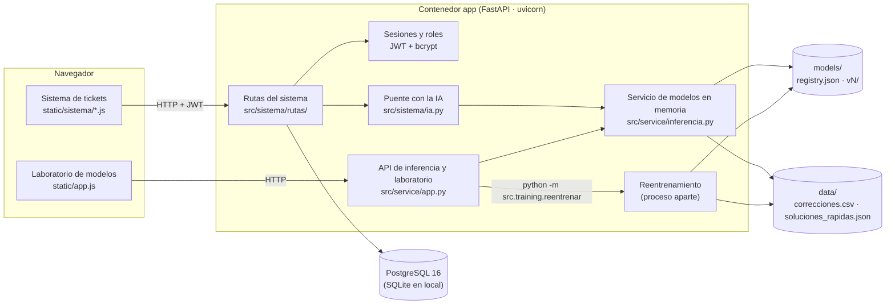
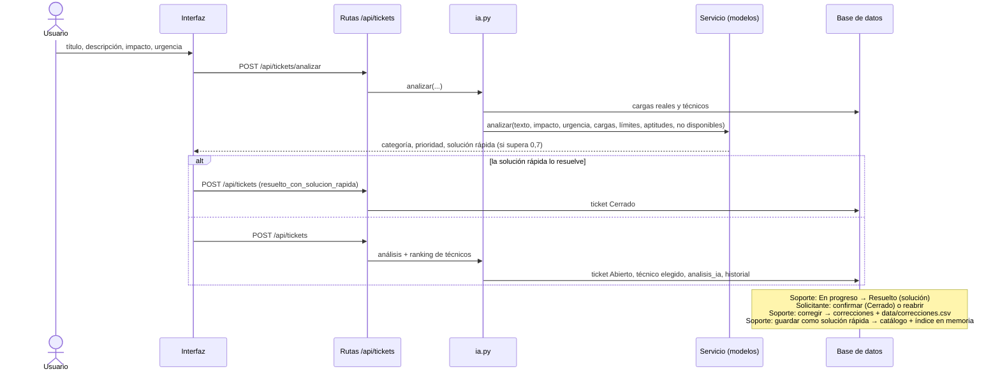

# Arquitectura

## 1. Componentes

| Componente | Tecnología | Responsabilidad |
|---|---|---|
| Interfaz del sistema | HTML + JavaScript sin dependencias (`src/service/static/sistema/`) | Pantallas por rol; guarda el token de sesión en `sessionStorage` |
| Laboratorio | HTML + JavaScript (`src/service/static/index.html`, `app.js`) | Probar los modelos, simular cargas, métricas, correcciones y reentrenamiento (acciones con cambios: solo Administrador) |
| API | FastAPI (`src/service/app.py`) | Rutas del sistema y de inferencia, manejo de errores en español, archivos estáticos, ciclo de vida (`lifespan`: carga modelos, crea tablas, siembra) |
| Seguridad | PyJWT + bcrypt (`src/sistema/seguridad.py`) | Inicio de sesión, `usuario_actual`, `requiere_rol(...)` |
| Persistencia | SQLAlchemy 2 (`src/sistema/db.py`, `modelos.py`) | 7 tablas (ver `docs/modelo_datos.md`) |
| Puente IA | `src/sistema/ia.py` | Pasa al servicio las cargas, límites, aptitudes y disponibilidad reales de la BD y guarda el análisis |
| Servicio de modelos | PyTorch CPU + scikit-learn (`src/service/inferencia.py`) | GRU (categoría y embedding), MLP de prioridad, MLP de asignación + balanceo, índice de similares, índice de soluciones rápidas. Un solo objeto en memoria compartido por toda la aplicación |
| Reentrenamiento | `src/training/reentrenar.py` en un subproceso | Entrena una versión nueva, la compara con la vigente en `test.csv` y la publica solo si no empeora; la API recarga el servicio |
| Despliegue | Docker Compose (`db` + `app`), volúmenes `pgdata`, `./models`, `./data` | Arranque automático (`restart: unless-stopped`), configuración en `.env` |

## 2. Flujo de un ticket

Dentro del servicio, un análisis hace: tokenización → **GRU bidireccional** (probabilidades de categoría + embedding de 512) → **MLP de prioridad** (embedding + probabilidades de categoría + impacto, urgencia y usuarios) → **MLP de asignación** (puntaje por técnico con categoría, prioridad, aptitud, ocupación y tiempo medio) → **reglas de balanceo** (saturados y no disponibles al final) → **similitud coseno** contra los tickets históricos y contra las frases del catálogo de soluciones rápidas (híbrido con TF-IDF de caracteres). Tiempo típico: 16–25 ms en CPU.

## 3. Aprendizaje continuo

1. Soporte corrige categoría o prioridad → fila en `correcciones` y en `data/correcciones.csv`.
2. Con al menos `MIN_CORRECCIONES_REENTRENAR` (5) correcciones válidas, el Administrador pulsa **Reentrenar** → subproceso: `train.csv` + correcciones (×3) → ajuste fino de la GRU desde la versión vigente → F1 macro en `test.csv` (tickets reales).
3. Si iguala o supera a la vigente: se reentrenan MLP de prioridad, asignación e índices, se registra `vN` como publicada y activa, y la API la carga sin reiniciar. Si empeora: se registra como descartada y se borran sus archivos.
4. El Administrador puede volver a cualquier versión publicada (`POST /api/modelos/activar`).
5. Verificación con datos nuevos del equipo: `src/training/ciclo_aprendizaje.py` (mitad A como correcciones, mitad B como evaluación, prueba negativa con etiquetas erróneas).

## 4. Mapa de archivos

| Ruta | Qué hace |
|---|---|
| `src/service/app.py` | Aplicación FastAPI: incluye las rutas del sistema, la API de inferencia y laboratorio, errores en español, reentrenamiento en subproceso, páginas |
| `src/service/inferencia.py` | Clase `Servicio`: carga una versión de modelos y analiza tickets; `recargar_soluciones()` |
| `src/service/schemas.py` | Esquemas de entrada y salida de la API de inferencia |
| `src/service/static/sistema/` | Interfaz del sistema: `nucleo.js` (sesión, menú, rutas), `tickets.js` (nuevo ticket, listas, detalle, guardar solución rápida), `admin.js` (técnicos, usuarios, soluciones rápidas, modelos, panel), `estilo.css` |
| `src/service/static/index.html`, `app.js` | Laboratorio de modelos |
| `src/sistema/config.py` | Variables de entorno (`DATABASE_URL`, `SECRETO_JWT`, `MIN_CORRECCIONES_REENTRENAR`, …) |
| `src/sistema/db.py`, `modelos.py`, `esquemas.py` | Conexión, tablas y esquemas del sistema |
| `src/sistema/seguridad.py` | Contraseñas, tokens JWT, `usuario_actual`, `requiere_rol` |
| `src/sistema/ia.py` | Puente entre el sistema y el servicio de modelos |
| `src/sistema/rutas/` | `auth`, `usuarios` (incluye Soporte ↔ técnico), `tickets`, `tecnicos`, `panel`, `soluciones` (HU26) |
| `src/sistema/semilla.py`, `semilla_historial.py` | Datos de demostración (`python -m src.sistema.semilla --reiniciar`) |
| `src/models/` | Definición de modelos: `gru_clasificador.py`, `mlp_prioridad.py`, `mlp_asignacion.py` (+ balanceo), `similitud.py`, `base.py` (TF-IDF + regresión logística), `catalogo_soluciones.py`, `comun.py` |
| `src/training/` | `entrenar_todo.py` y un script por modelo, `evaluar.py`, `registro.py` (versiones), `reentrenar.py`, `evaluar_prueba_equipo.py`, `ciclo_aprendizaje.py` |
| `src/data/` | Preparación de datos: inventario, unificación, traducción, filtrado, etiquetado (`mapeo.py`), auditoría, aumento, división, datos auxiliares, soluciones rápidas, validación del conjunto del equipo |
| `models/` | `registry.json` y una carpeta por versión (pesos, vocabulario, índices, métricas) |
| `data/processed/` | Datos listos para entrenar y catálogo de soluciones rápidas; `data/prueba_equipo/` conjunto independiente del equipo |
| `reports/` | Informes de datos y de modelos, rendimiento, pruebas, verificación de instalación, aceptación; `figuras/` |
| `docs/` | Manuales, arquitectura, CRISP-ML(Q), modelo de datos, contrato de API, plan de pruebas |
| `tests/` | Pruebas automáticas (pytest); `tests/e2e/` prueba de extremo a extremo con Playwright |
| `scripts/` | `prueba_humo.py`, `medir_rendimiento.py`, `capturas_manual.py` |
| `Dockerfile`, `docker-compose.yml`, `.env.ejemplo` | Despliegue |
