# Manual de usuario

Mesa de ayuda TI con inteligencia artificial. Este manual tiene un capítulo por rol: **Usuario** (registra tickets), **Soporte** (técnico que los atiende) y **Administrador**. Las capturas son de la aplicación real con los datos de demostración (`scripts/capturas_manual.py`).

## Inicio de sesión

Abrir la dirección del sistema (por ejemplo `http://localhost:8001`) e ingresar correo y contraseña. En la instalación de demostración, los botones de la parte inferior rellenan las cuentas de prueba.

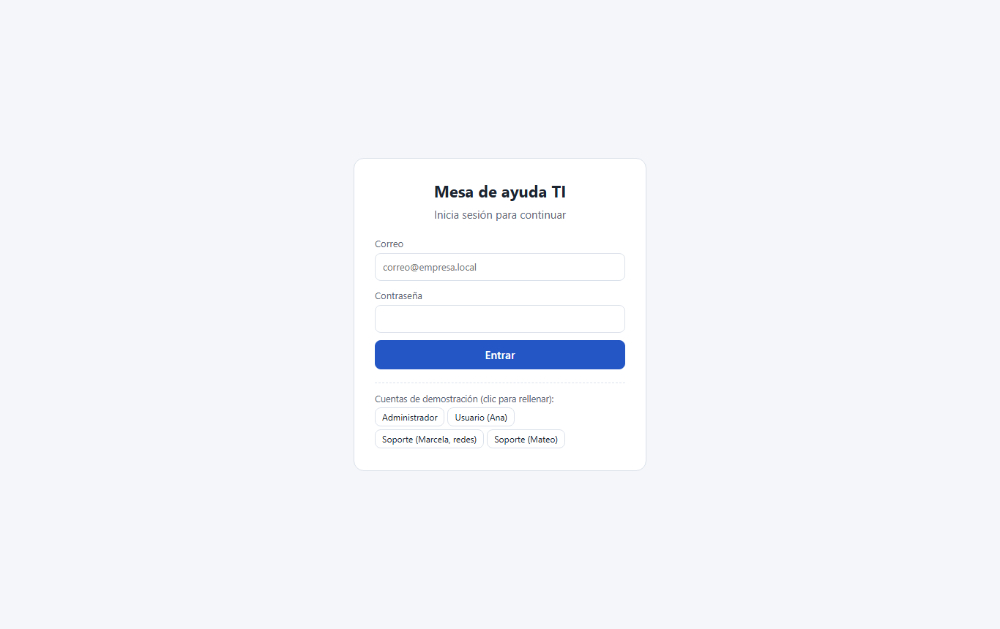

Cada rol ve su propio menú a la izquierda. «Cerrar sesión» está abajo; la sesión dura 8 horas.

---

## 1. Usuario

### 1.1 Registrar un ticket

1. Menú **Nuevo ticket**.
2. Escribir un **título** y una **descripción** del problema con tus palabras.
3. Indicar el **impacto** (a cuánta gente o trabajo afecta), la **urgencia** (cuánto puede esperar) y los **usuarios afectados**.
4. Pulsar **Analizar**. La IA muestra la categoría que detecta, su confianza y la prioridad.

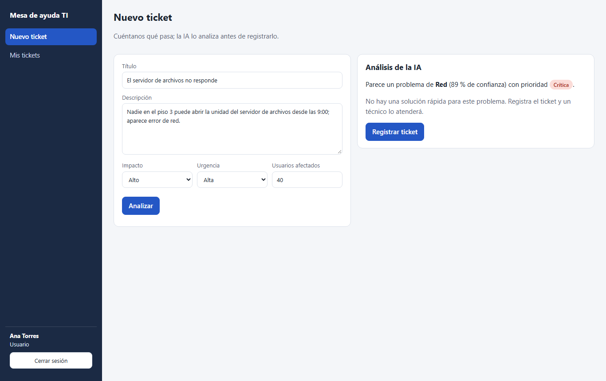

5. Pulsar **Registrar ticket**. El sistema confirma el código (TK-…), la clasificación y el técnico asignado.

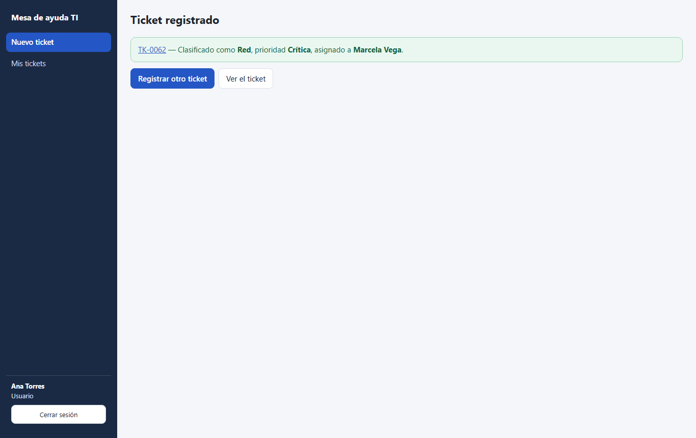

### 1.2 Soluciones rápidas

Si el problema es común (contraseña, correo, internet, impresora…), la IA propone **pasos para resolverlo tú mismo** antes de registrar el ticket:

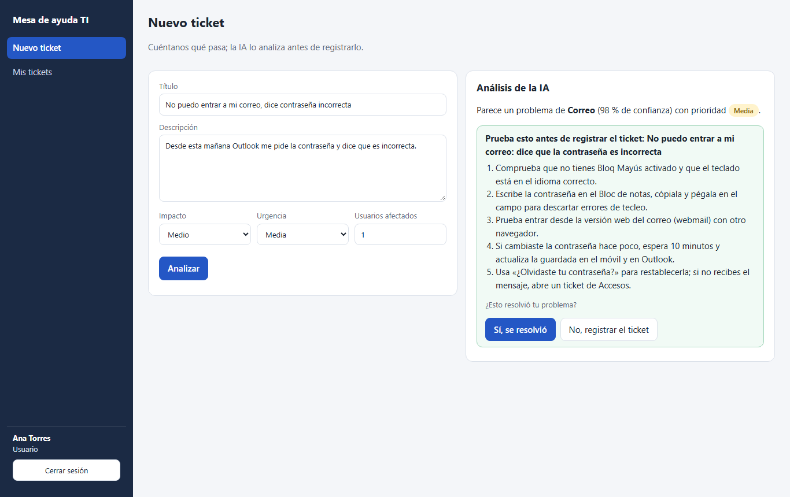

- **Sí, se resolvió:** el ticket queda registrado y **Cerrado** como resuelto con solución rápida (sirve para las estadísticas).
- **No, registrar el ticket:** se registra normalmente y se asigna a un técnico.

### 1.3 Seguir mis tickets

Menú **Mis tickets**: lista de tus tickets con su estado, prioridad y técnico. Se puede filtrar por estado. Al abrir uno se ve la descripción, los comentarios del técnico, el historial y, si está resuelto, la solución.

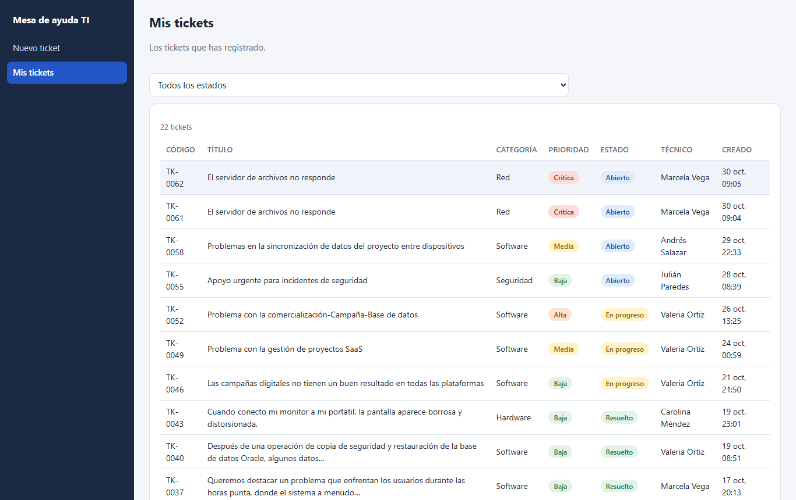

### 1.4 Confirmar o reabrir

Cuando el técnico marca el ticket como **Resuelto**, en su detalle aparecen dos botones:

- **Confirmar y cerrar:** el problema quedó solucionado → pasa a **Cerrado**.
- **Reabrir: sigue el problema** → vuelve a **En progreso** con el mismo técnico.

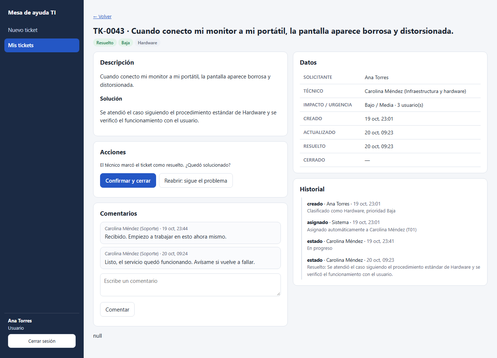

También puedes escribir **comentarios** para dar más información al técnico.

---

## 2. Soporte (técnico)

### 2.1 Bandeja de tickets

Menú **Bandeja de tickets**: los tickets asignados a ti, ordenados para atender primero lo abierto, lo **Crítico** y lo más antiguo.

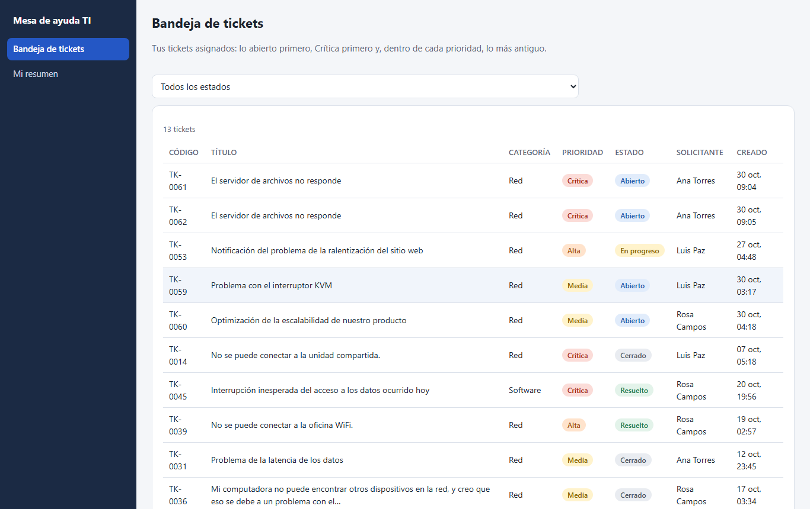

### 2.2 Atender un ticket

En el detalle del ticket:

1. **Pasar a En progreso** al empezar a trabajar.
2. Comentar para informar al usuario.
3. Escribir la **Solución aplicada** (obligatoria) y pulsar **Marcar como resuelto**. El usuario confirmará o reabrirá.
4. **Corregir la clasificación de la IA** si la categoría o la prioridad no son correctas. La corrección queda registrada y se usa para **reentrenar** los modelos.
5. **Devolver: que la IA elija otro técnico** si el ticket no te corresponde.

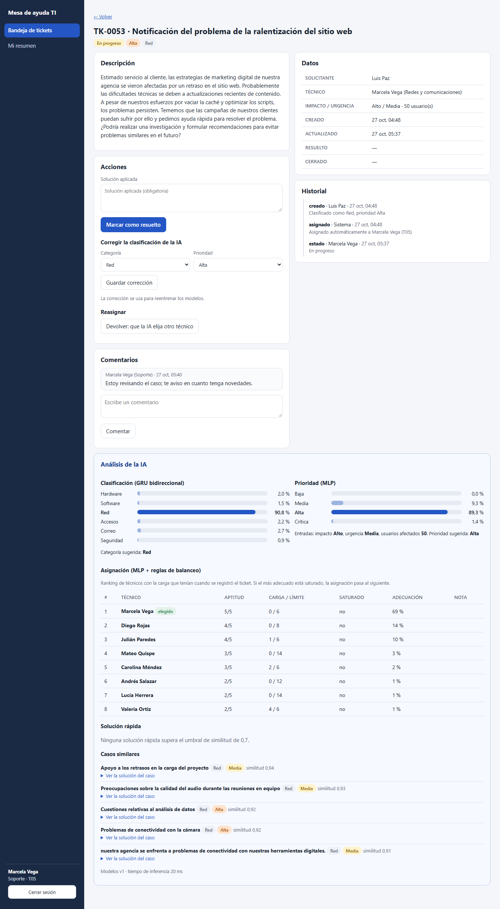

### 2.3 Guardar una solución rápida

En un ticket **Resuelto** o **Cerrado** que atendiste, si el problema es frecuente, pulsa **Guardar como solución rápida**. El formulario viene rellenado con el título, la descripción resumida y la solución registrada; ajústalo:

- **Problema:** cómo lo vería el usuario.
- **Frases de ejemplo** (una por línea): distintas formas en que un usuario lo describiría. Cuantas más y más variadas, mejor la detecta la IA.
- **Pasos** (uno por línea): instrucciones claras que el usuario pueda seguir solo.

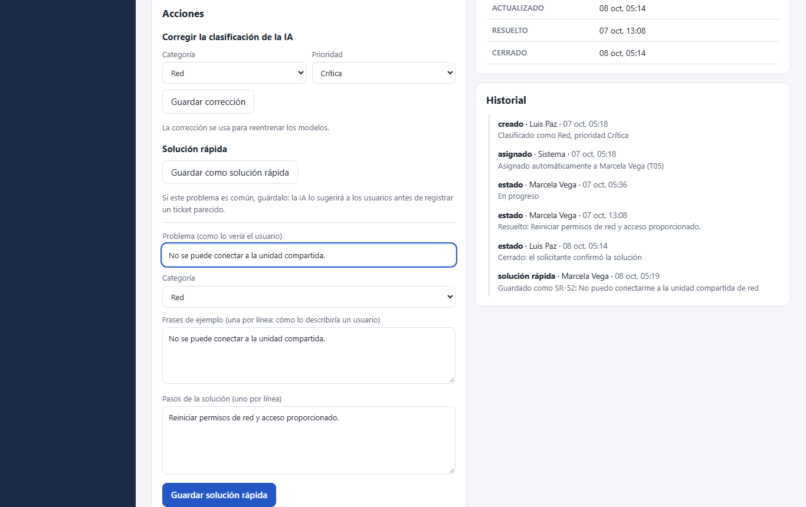

Al guardar, la solución se agrega al catálogo y **la IA la sugiere de inmediato** a los tickets nuevos parecidos (no hace falta reiniciar nada). El Administrador puede editarla o desactivarla.

### 2.4 Mi resumen

Menú **Mi resumen**: tus tickets abiertos, resueltos y tiempos de resolución.

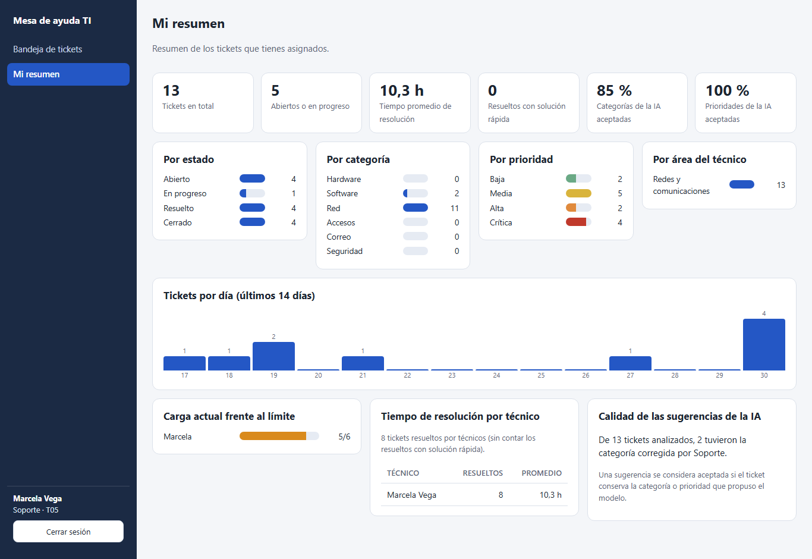

---

## 3. Administrador

### 3.1 Panel de métricas

Indicadores del servicio (tickets por estado, categoría y prioridad, tiempos de resolución, carga por técnico) y de la IA (aciertos de categoría según las correcciones, soluciones rápidas usadas).

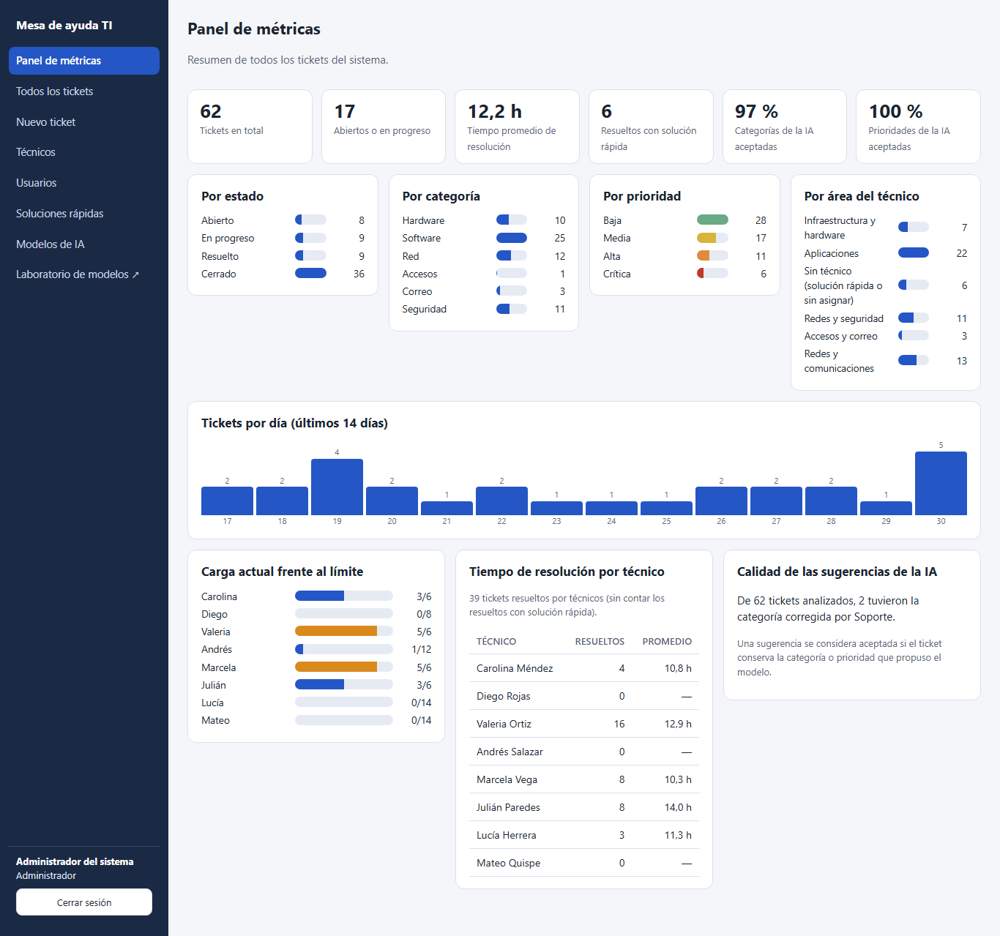

### 3.2 Todos los tickets

Lista completa con filtros por estado, categoría y prioridad. En el detalle, además de lo que hace Soporte, el Administrador puede **reasignar manualmente** a cualquier técnico.

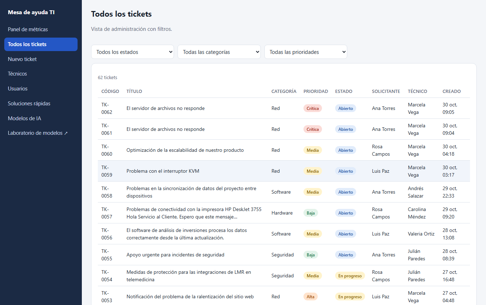

### 3.3 Técnicos

Para cada técnico: carga actual, **límite de carga**, **disponible** (sí/no) y **aptitudes** de 1 a 5 por categoría. La IA usa estos datos en la próxima asignación: un técnico no disponible o en su límite no recibe tickets si hay otro con capacidad.

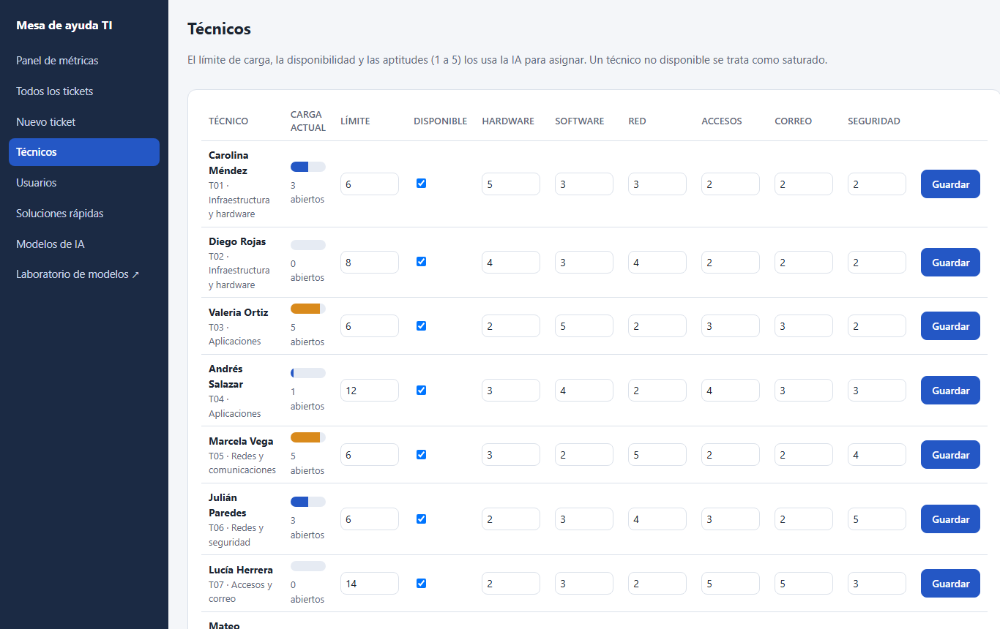

### 3.4 Usuarios

Crear usuarios, cambiar su rol, activarlos/desactivarlos y cambiar contraseñas. Un usuario con rol **Soporte** se convierte automáticamente en técnico (con aptitudes 3 y límite 8, editables en *Técnicos*); si deja de ser Soporte o se desactiva, deja de recibir tickets.

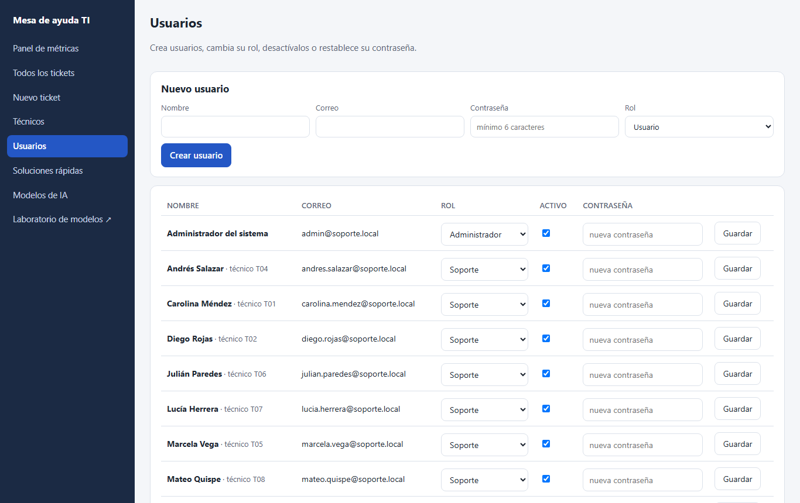

### 3.5 Soluciones rápidas

Catálogo de soluciones rápidas: buscar, **Editar** (problema, categoría, frases y pasos) y **Activar/Desactivar**. Solo las activas se sugieren. Las agregadas desde un ticket muestran su origen y autor. Los cambios se aplican al instante.

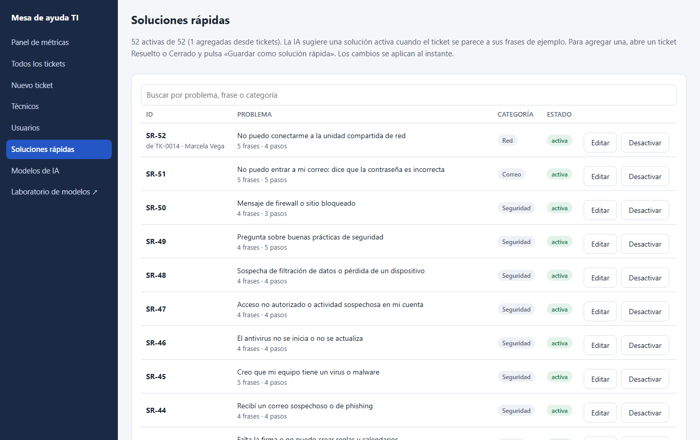

### 3.6 Modelos de IA

Versión activa, métricas, criterios de aceptación, historial de versiones y **reentrenamiento**:

- **Reentrenar con las correcciones:** entrena una versión nueva con las correcciones acumuladas (mínimo 5) y la compara con la vigente en un conjunto de referencia fijo. **Solo se publica si no empeora**; si empeora queda como *descartada* y el sistema sigue con la versión anterior. Tarda unos minutos y no interrumpe el servicio.
- **Activar** una versión publicada anterior (restaurar) si fuera necesario.

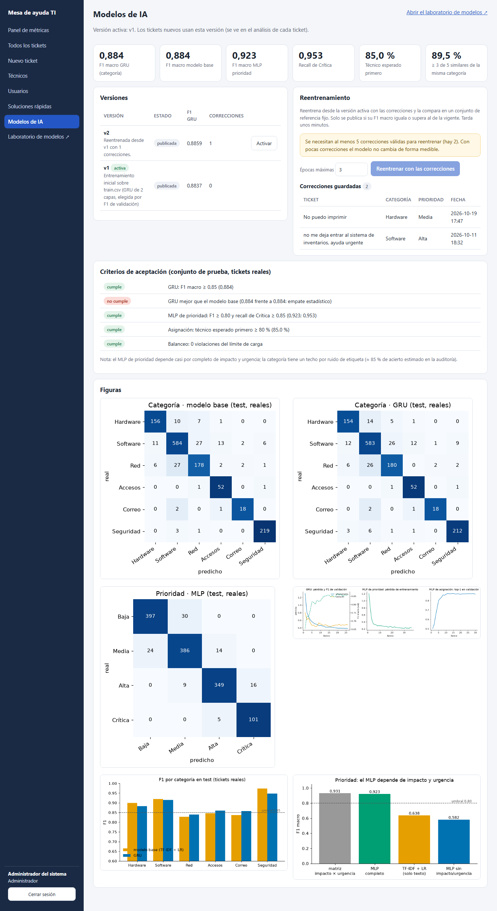

### 3.7 Laboratorio de modelos

Enlace **Laboratorio de modelos** del menú: página técnica para probar los modelos con cualquier texto, simular cargas de técnicos y ver métricas detalladas. Las acciones que cambian datos piden iniciar sesión como Administrador.

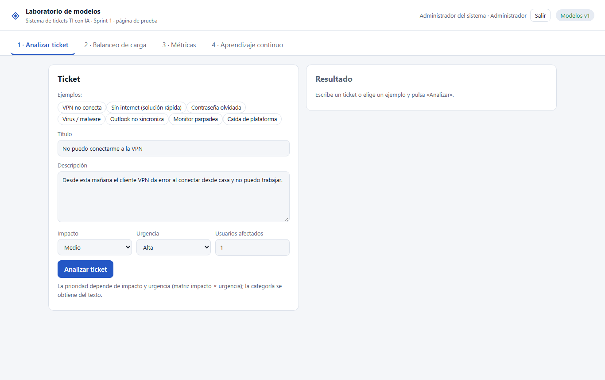

---

## 4. Cómo leer el análisis de la IA

Soporte y Administrador ven el panel **Análisis de la IA** en cada ticket (captura de la sección 2.2):

| Parte | Qué significa |
|---|---|
| **Clasificación (GRU bidireccional)** | Probabilidad de cada categoría según el texto. La más alta es la sugerida. Una confianza baja (< 60 %) indica un texto ambiguo: conviene revisar y corregir si hace falta |
| **Prioridad (MLP)** | Probabilidad de cada prioridad. Depende sobre todo del impacto y la urgencia (Alto + Alta = Crítica) y del número de usuarios afectados |
| **Asignación (MLP + reglas de balanceo)** | Ranking de técnicos: aptitud en la categoría, carga/límite en el momento del registro, si estaba saturado y la **adecuación** calculada por el modelo. El marcado como *elegido* recibió el ticket. La **nota** explica cuando el más adecuado se saltó por estar saturado o no disponible |
| **Solución rápida** | La solución del catálogo más parecida, si supera el umbral de similitud (0,7) |
| **Casos similares** | Los 5 tickets históricos más parecidos con su similitud (0 a 1) y su solución: útiles para resolver más rápido |
| Pie | Versión de los modelos usada y tiempo de inferencia |

La IA **sugiere**; las personas deciden. Toda corrección de Soporte se guarda y sirve para que la siguiente versión de los modelos aprenda de sus errores.
