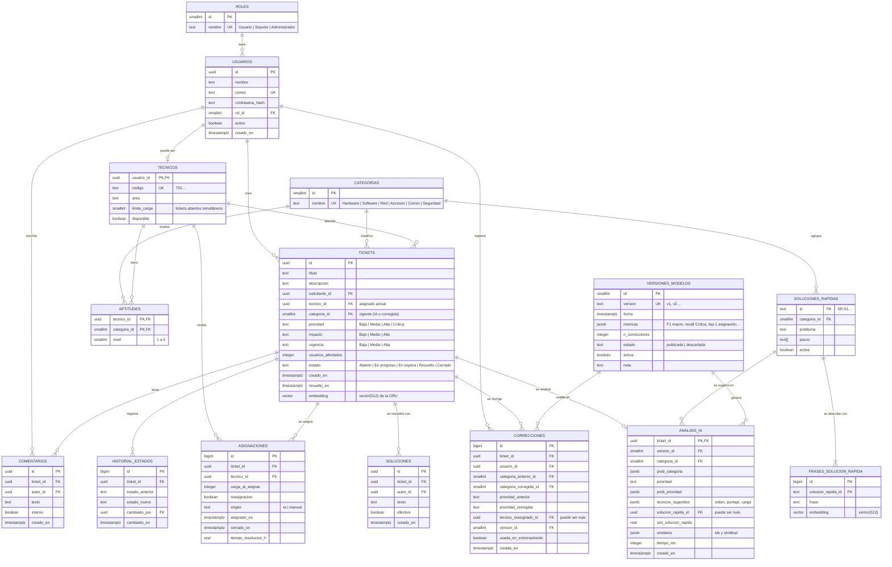

# Modelo de datos (Sprint 2)

Diseño de la base de datos de la aplicación web (FastAPI + PostgreSQL con la extensión `pgvector`). Parte de los datos y modelos del Sprint 1:
las categorías, prioridades, impacto y urgencia son los de `reports/reglas_etiquetado.md`; los técnicos, aptitudes, historial y soluciones rápidas tienen el formato de `data/processed/`;
las versiones de modelos corresponden a `models/registry.json`.

## Diagrama entidad-relación

## Tablas

### Usuarios y roles
- **`roles`**: `Usuario`, `Soporte`, `Administrador`. Un usuario crea y consulta sus tickets; Soporte los atiende y corrige; Administrador gestiona usuarios, técnicos, correcciones y versiones de modelos.
- **`usuarios`**: autenticación (la contraseña se guarda con hash, nunca en claro) y rol.
- **`tecnicos`**: extiende a un usuario con rol Soporte. `limite_carga` es el número máximo de tickets abiertos a la vez; la **carga actual no se guarda**, se calcula: `SELECT count(*) FROM tickets WHERE tecnico_id = … AND estado NOT IN ('Resuelto','Cerrado')`.
- **`aptitudes`**: nivel 1–5 por técnico y categoría. Restricción de negocio del Sprint 1: al menos 2 técnicos con nivel ≥ 4 por categoría (`aptitud_*` de `tecnicos.csv`).

### Tickets
- **`tickets`**: los campos que el usuario escribe (`titulo`, `descripcion`, `impacto`, `urgencia`, `usuarios_afectados`) y los vigentes (`categoria_id`, `prioridad`, `tecnico_id`, `estado`). `categoria_id` y `prioridad` empiezan con lo que predijo la IA y cambian si Soporte los corrige. `prioridad` debe ser coherente con la matriz impacto × urgencia (Alto + Alta = Crítica), con excepciones permitidas. `embedding` guarda el vector de 512 dimensiones de la GRU para la búsqueda de casos similares (`CREATE INDEX … USING hnsw (embedding vector_cosine_ops)`).
- **`analisis_ia`**: respuesta de `POST /api/analizar` para cada ticket, con la versión de los modelos que la generó (auditoría y comparación de versiones). Las probabilidades y los técnicos sugeridos van en `jsonb`.
- **`comentarios`**: conversación del ticket; `interno = true` solo lo ve Soporte.
- **`historial_estados`**: cada cambio de estado, quién lo hizo y cuándo (trazabilidad y tiempos de resolución).
- **`asignaciones`**: cada asignación o reasignación de un ticket a un técnico, con la carga que tenía en ese momento y el origen (`ia` si aceptó la sugerencia, `manual` si la cambió). Es el historial que alimenta el MLP de asignación (equivalente a `historial_asignaciones.csv`).
- **`soluciones`**: texto con el que se resolvió un ticket y si fue efectiva. Las soluciones de tickets cerrados alimentan «casos similares».

### Soluciones rápidas
- **`soluciones_rapidas`** y **`frases_solucion_rapida`**: equivalentes a `soluciones_rapidas.json` (50 entradas con 3–5 frases cada una). Los embeddings de las frases permiten buscar con pgvector; el umbral de similitud se guarda en la configuración de la versión del modelo.

### Aprendizaje continuo
- **`correcciones`**: lo que Soporte cambió respecto a la IA (categoría, prioridad, técnico). Equivalen a las filas de `data/correcciones.csv`. `usada_en_entrenamiento` evita contarlas dos veces cuando se reentrena.
- **`versiones_modelos`**: equivalente a `models/registry.json`. Solo una versión está activa. Una versión descartada (empeoraba el F1 macro) se conserva con su estado y sus métricas.

## Reglas de integridad
1. `usuarios.rol_id` obligatorio; `tecnicos.usuario_id` solo para usuarios con rol Soporte.
2. `tickets.categoria_id`, `prioridad`, `impacto` y `urgencia` con `CHECK` sobre los valores de la taxonomía.
3. Un técnico no puede tener más tickets abiertos que `limite_carga`, salvo cuando **todos** estén al límite (regla de balanceo); la asignación manual puede superarlo y queda registrada como `origen = manual`.
4. Una versión activa como máximo (`UNIQUE INDEX … WHERE activa`).
5. `historial_estados` y `analisis_ia` son de solo inserción.

## Equivalencias con los datos del Sprint 1

| Archivo / API del Sprint 1 | Tabla del Sprint 2 |
|---|---|
| `tickets.csv` (`titulo`, `descripcion`, `categoria`, `prioridad`, `impacto`, `urgencia`, `usuarios_afectados`, `solucion`) | `tickets`, `soluciones` |
| `tecnicos.csv` | `tecnicos`, `aptitudes` |
| `historial_asignaciones.csv` | `asignaciones` |
| `soluciones_rapidas.json` | `soluciones_rapidas`, `frases_solucion_rapida` |
| `data/correcciones.csv` | `correcciones` |
| `models/registry.json` | `versiones_modelos` |
| respuesta de `POST /api/analizar` | `analisis_ia` (+ `tickets.embedding`) |
