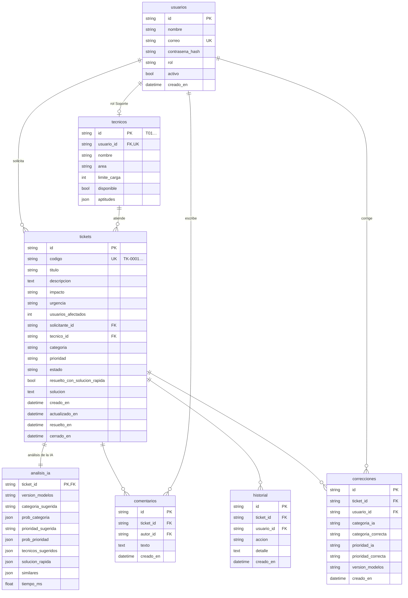

# Modelo de datos

Base de datos de la aplicación (SQLAlchemy 2; **SQLite** en local, **PostgreSQL 16** en Docker; los tipos son portables entre ambos). Definición en `src/sistema/modelos.py`; las tablas se crean al arrancar (`src/sistema/db.py`). Algunos datos viven en archivos, no en la BD, porque los comparten el servicio de inferencia, el laboratorio y el entrenamiento (sección 3).

> El diseño inicial del Sprint 2 preveía tablas separadas para roles, aptitudes, asignaciones y soluciones, y `pgvector` para los embeddings. Se simplificó: roles y aptitudes como columnas, asignaciones y cambios de estado en `historial`, y la búsqueda de similares en memoria con los índices de la versión de modelos (≈ 7 500 tickets, < 30 ms).

## 1. Diagrama entidad-relación

## 2. Tablas

| Tabla | Contenido | Notas |
|---|---|---|
| `usuarios` | Cuentas de los tres roles (`Usuario`, `Soporte`, `Administrador`) | Contraseña con bcrypt, nunca en claro. `activo = false` impide iniciar sesión |
| `tecnicos` | Ficha de técnico de cada usuario Soporte: área, `limite_carga`, `disponible` y `aptitudes` (`{"Hardware": 5, …}`, 1 a 5) | Se crea al crear un usuario Soporte (o al cambiarle el rol). La **carga no se guarda**: se cuenta como tickets `Abierto` o `En progreso` del técnico |
| `tickets` | Lo que escribe el solicitante y lo vigente: `categoria`, `prioridad` (empiezan con la sugerencia de la IA y cambian si se corrigen), `tecnico_id`, `estado`, `solucion` y fechas | `codigo` correlativo `TK-0001`. Estados: Abierto → En progreso → Resuelto → Cerrado (Resuelto → En progreso al reabrir) |
| `analisis_ia` | Respuesta completa de la IA al registrar el ticket, con la versión de modelos que la generó | Solo inserción: permite auditar y comparar versiones aunque el ticket se corrija después |
| `comentarios` | Conversación del ticket | Visibles para el solicitante, el técnico y el Administrador |
| `historial` | Trazabilidad: `creado`, `asignado`, `reasignado`, `estado` (incluye reaperturas), `corregido`, `solución rápida` | Solo inserción. Alimenta los tiempos de resolución del panel |
| `correcciones` | Categoría y prioridad de la IA frente a las corregidas por Soporte | También se escriben en `data/correcciones.csv` para el reentrenamiento. El panel calcula con ellas el % de sugerencias aceptadas |

### Reglas de integridad y de negocio

1. Valores de categoría, prioridad, impacto, urgencia, estado y rol validados en la API (esquemas Pydantic con los valores de la taxonomía).
2. Un técnico no recibe tickets nuevos si está no disponible o en su límite mientras haya otro con capacidad (reglas de balanceo); si todos están al límite, se elige el de menor ocupación. La reasignación manual del Administrador puede superarlo y queda en `historial`.
3. Solo el solicitante confirma o reabre; solo el técnico asignado o el Administrador cambian el estado, corrigen o reasignan.
4. `analisis_ia` e `historial` no se modifican después de escribirse.

## 3. Datos en archivos

| Archivo | Contenido | Quién lo escribe |
|---|---|---|
| `models/registry.json` y `models/vN/` | Versiones de los modelos (pesos, vocabulario, índices, métricas), cuál está activa y las descartadas | Entrenamiento y reentrenamiento; restauración desde la pantalla Modelos |
| `data/processed/soluciones_rapidas.json` | Catálogo de soluciones rápidas: `id`, `categoria`, `problema`, `frases_ejemplo`, `pasos`, `activa` y, si se guardó desde un ticket, `origen`, `ticket_origen`, `creada_por`, `fecha` (HU26) | Soporte y Administrador desde la aplicación (escritura atómica). Se eligió un archivo y no una tabla porque lo leen igual el servicio, el laboratorio y el reentrenamiento; en Docker persiste en el volumen `./data` |
| `data/correcciones.csv` | Correcciones para el reentrenamiento (`titulo, descripcion, categoria_corregida, prioridad_corregida, tecnico_reasignado, impacto, urgencia, usuarios_afectados, fecha`) | Al corregir un ticket o desde el laboratorio |
| `data/processed/tecnicos.csv`, `historial_asignaciones.csv`, `train/val/test.csv` | Datos de entrenamiento (Sprint 1) | Scripts de `src/data/` |

## 4. Equivalencias con los datos del Sprint 1

| Archivo / API del Sprint 1 | En el sistema |
|---|---|
| `tecnicos.csv` | `tecnicos` (semilla) |
| respuesta de `POST /api/analizar` | `analisis_ia` |
| `data/correcciones.csv` | `correcciones` (+ el mismo CSV) |
| `soluciones_rapidas.json` | el mismo archivo, ahora administrable |
| `models/registry.json` | el mismo archivo (pantalla Modelos de IA) |
| `test.csv` (tickets reales) | textos de los 60 tickets de demostración (`src/sistema/semilla_historial.py`) |
