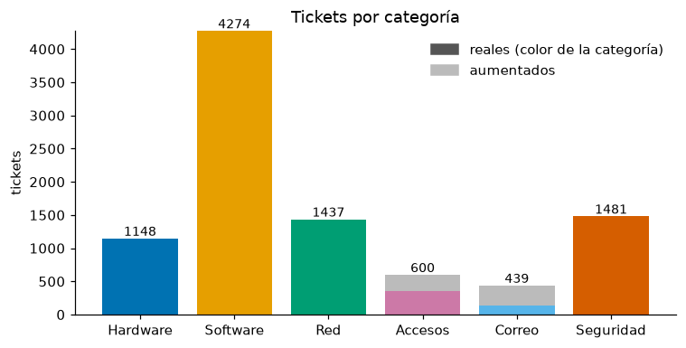
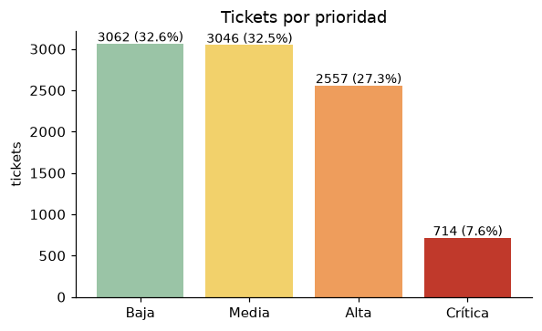
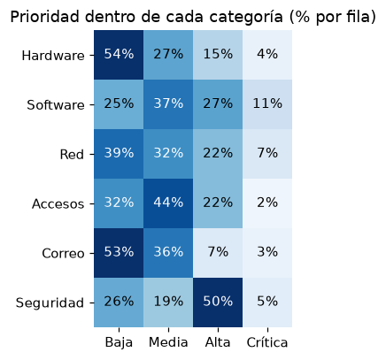
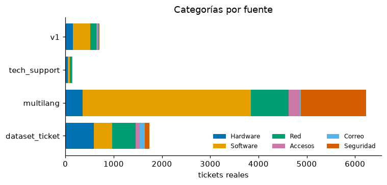
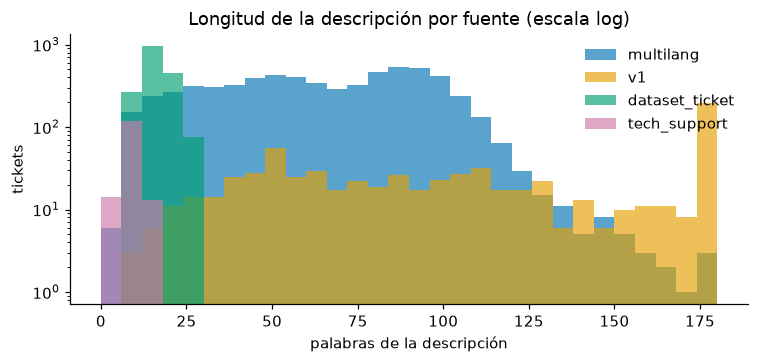
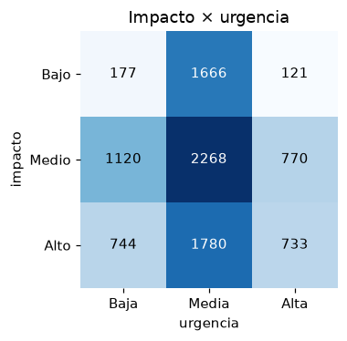

# Análisis exploratorio (paso 5)

Base: `data/processed/tickets.csv` — 9379 tickets (8834 reales y 545 aumentados). Notebook: `notebooks/01_eda.ipynb`.

## 1. Distribución de categorías

| categoria   |   aumentados |   reales |   All |
|:------------|-------------:|---------:|------:|
| Hardware    |            0 |     1148 |  1148 |
| Software    |            0 |     4274 |  4274 |
| Red         |            0 |     1437 |  1437 |
| Accesos     |          246 |      354 |   600 |
| Correo      |          299 |      140 |   439 |
| Seguridad   |            0 |     1481 |  1481 |
| All         |          545 |     8834 |  9379 |

- Software es casi la mitad (45 %): en la fuente principal casi todo fallo de aplicación o plataforma es Software.
- **Desbalance:** Software : Correo ≈ 10 : 1. Correo y Accesos están reforzados con variantes aumentadas (Correo solo 32 % real). Para entrenar se usarán pesos por clase y se reportará F1 macro y por clase.

## 2. Distribución de prioridades

- Baja 32,6 %, Media 32,5 %, Alta 27,3 %, Crítica 7,6 %: Crítica es la clase minoritaria; el criterio del MLP exige recall ≥ 0,85 en ella.

## 3. Categoría × prioridad

- Seguridad concentra las prioridades altas (los incidentes pasan a Alta como mínimo tras la auditoría); Hardware y Correo son sobre todo Baja (la mayoría viene de `Dataset_ticket.xlsx`, cuya prioridad se deriva del texto).
- Cuidado: la prioridad depende de la categoría y de la fuente; el modelo podría usar la categoría como atajo. Se mide también por fuente.

## 4. Fuentes

| fuente         |   Hardware |   Software |   Red |   Accesos |   Correo |   Seguridad |
|:---------------|-----------:|-----------:|------:|----------:|---------:|------------:|
| dataset_ticket |        592 |        375 |   484 |        92 |      100 |         102 |
| multilang      |        354 |       3492 |   778 |       235 |       18 |        1358 |
| tech_support   |         46 |         52 |    43 |         4 |        0 |           0 |
| v1             |        156 |        355 |   132 |        23 |       22 |          21 |

- La fuente principal domina Seguridad, Software y Red; `Dataset_ticket.xlsx` aporta casi todo Hardware y Correo reales.
- Riesgo de que el modelo aprenda el **estilo de la fuente** (plantilla larga frente a frase corta) en vez de la categoría. Hay que revisar la matriz de confusión por fuente (paso 7) y el conjunto de prueba del equipo (SCRUM-100).

## 5. Longitud de los textos

Palabras de la descripción (tickets reales):

| categoria   |   count |   mean |   50% |   90% |   max |
|:------------|--------:|-------:|------:|------:|------:|
| Hardware    |    1148 |   44.9 |  20   | 102   |   319 |
| Software    |    4274 |   64.6 |  62   | 102   |   377 |
| Red         |    1437 |   52.9 |  41   | 101   |   333 |
| Accesos     |     354 |   48.9 |  42.5 |  97.7 |   308 |
| Correo      |     140 |   41.3 |  17   | 107.4 |   233 |
| Seguridad   |    1481 |   58.2 |  55   | 100   |   357 |

- El 4.6% de los tickets supera 120 palabras; con `max_len = 128` tokens de la GRU se trunca muy poco (máximo ≈ 175 palabras).
- `Dataset_ticket.xlsx` y `tech-support` son frases de 5–25 palabras; la fuente principal y la v1, párrafos de 40–120.

## 6. Impacto y urgencia

- Excepciones a la matriz impacto × urgencia → prioridad: 7.0%.
- Urgencia Media y impacto Medio dominan; Bajo/Baja y Alto/Alta son menos frecuentes.

## 7. Vocabulario (solo train)

- 8351 palabras distintas; 6089 aparecen al menos 2 veces (vocabulario candidato de la GRU).
- Fracción de palabras de test fuera de ese vocabulario (OOV): 1.3%.

Términos más distintivos por categoría (TF-IDF medio frente al resto):

| Categoría | Términos |
|---|---|
| Hardware | teclado, computadora, monitor, ratón, memoria, pantalla, disco, hardware, cuando, portátil |
| Software | análisis, integración, plataforma, saas, gestión, proyectos, inversión, software, rendimiento, optimización |
| Red | conexión, conectividad, router, problemas, dispositivos, internet, configuración, dirección, dhcp, línea |
| Accesos | sesión, inicio, acceso, permiso, servidor, usuario, usuarios, acceder, dificultades, puedo |
| Correo | correos, electrónicos, correo, electrónico, algunos, outlook, enviar, enviados, bandeja, recibidos |
| Seguridad | seguridad, médicos, datos, acceso, sistemas, violación, hospital, autorizado, protocolos, medidas |

- Hardware, Correo, Red y Accesos se separan por vocabulario de problema (teclado, monitor; correos, outlook; router, dhcp; sesión, permiso).
- **Riesgo de atajo:** Seguridad se distingue sobre todo por el relato de plantilla (*médicos, hospital, datos, protocolos*) y Software por *análisis, inversión, plataforma, saas, proyectos*. Un modelo puede aprender el escenario en vez del problema. Hay que comprobarlo con el conjunto de prueba del equipo (SCRUM-100) y con tickets de `Dataset_ticket.xlsx`, donde no existe ese relato.

## 8. Ejemplos por clase (tickets reales)

- **Hardware** · Crítica · multilang: *Asistencia para el desempeño del sistema* — Equipo de atención al cliente, que compone este informe para resaltar el deterioro significativo en el rendimiento del sistema observado en múltiples dispositivos y softw…
- **Hardware** · Media · multilang: *Apoyo a las cuestiones del sistema* — Una empresa financiera está experimentando inestabilidad del sistema; las herramientas de búsqueda de inversiones se ven afectadas desde la instalación de nuevas actualiz…
- **Software** · Media · multilang: *Solicitud de implementación de la integración MySQL y Microsoft Dynamics 365 en la gestión* — Solicitar la implementación de la integración entre MySQL y Microsoft Dynamics 365 dentro de nuestra plataforma SaaS de gestión de proyectos. Esta integración permitirá u…
- **Software** · Crítica · multilang: *Solicitud de soporte para un problema crítico* — Estimado Equipo de Atención al Cliente, estamos reportando un problema crítico que ha afectado a múltiples productos, involucrando integraciones de software y hardware. E…
- **Red** · Crítica · multilang: *Servicio Regular Interruptions During Busy Hours* — Las interrupciones regulares del servicio ocurren durante los tiempos pico.…
- **Red** · Media · multilang: *Problemas de conectividad de red* — Apoyo Sehr geehrter, Me dirijo a usted para informar de los problemas con la conexión de red que afectan a varios dispositivos de nuestra agencia. Estos dispositivos pier…
- **Accesos** · Media · multilang: *Informe del problema* — Atención al cliente, Me estoy enfrentando a dificultades con el proceso centralizado de administración de cuentas. Aunque las características parecen estar funcionando no…
- **Accesos** · Alta · multilang: *Problema con la plataforma de inicio de sesión* — Los usuarios se enfrentan a problemas ocasionales de inicio de sesión en la plataforma, que podrían estar relacionados con actualizaciones recientes del servidor de auten…
- **Correo** · Media · multilang: *Enfrentando problemas de conectividad de correo electrónico con Outlook, impactando la com* — Enfrentando problemas de conectividad de correo electrónico con Outlook, impactando la comunicación del cliente y actualizaciones del proyecto. El problema podría derivar…
- **Correo** · Alta · multilang: *Bajas tasas de participación en campañas de marketing digital* — Observamos baja participación y tasa de conversión para nuestras campañas de marketing digital. Estrategias antiguas y objetivos no selectivos podrían ser la causa. Compr…
- **Seguridad** · Crítica · multilang: *Implementación crítica de parches de seguridad* — Implementar una actualización de seguridad crítica para mejorar la estabilidad de los sistemas de protección de datos en las soluciones hospitalarias impactadas.…
- **Seguridad** · Alta · multilang: *Problemas de acceso de datos de productos de seguridad* — Un proveedor de atención médica encontró dificultades de acceso a los datos que impactaron varias soluciones de seguridad. El problema puede deberse a configuraciones de …

## 9. Hallazgos para el entrenamiento

1. Usar **pesos por clase** (o muestreo) para Accesos, Correo y para la prioridad Crítica.
2. Evaluar sobre **tickets reales** (excluir `origen_etiqueta == aumento`) y reportar por fuente.
3. El ruido de etiqueta estimado en la fuente principal (≈ 15 % en categoría, `reports/auditoria_etiquetas.md`) limita el F1 alcanzable.
4. Dos regímenes de texto (frases cortas y párrafos): considerar `max_len` 128 y relleno al final con máscara.
5. Vigilar el atajo por escenario (médicos/hospital → Seguridad) con un conjunto de prueba sin esos relatos.
6. Crítica solo se deriva de la fuente `tech-support` (urgent), de la fuente principal con reglas y de la v1: comprobar que el MLP no se limite a memorizar esas reglas.
